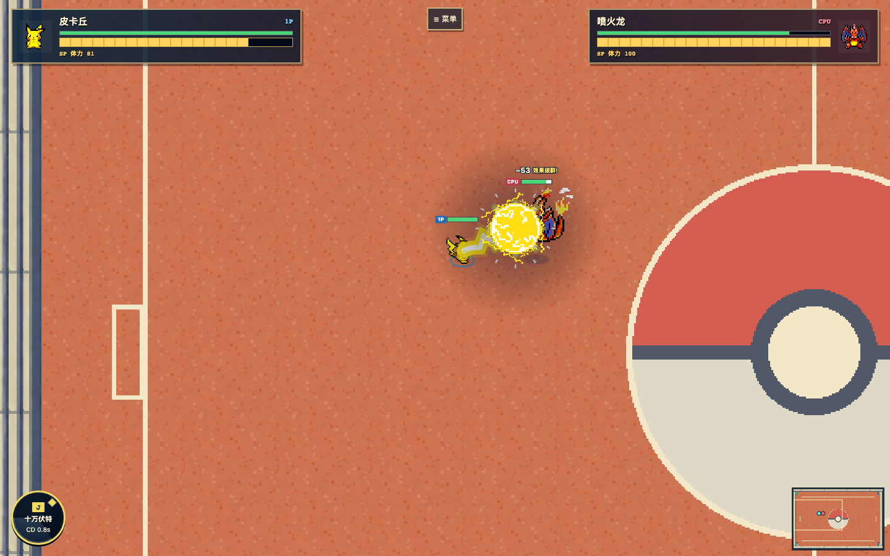

# Poight · 像素竞技场
浏览器里的即时 1v1 宝可梦同人对战。

## ▶ 在线试玩：[poight.jiachengbo.com](https://poight.jiachengbo.com/)
[](https://poight.jiachengbo.com/)

[](https://poight.jiachengbo.com/)

手机请横屏，电脑浏览器体验最好。

灵感与致敬：《宝可梦：羁绊之旅》by B站 @瓜瓜的探索日记 —— https://www.bilibili.com/video/BV16bHd6jE1a/
Inspired by and paying tribute to "Pokémon: Bond Journey" by Bilibili creator @瓜瓜的探索日记.

## 简介 / About

Poight 是非官方、非商业的浏览器像素竞技场：50 只角色、120 招，即时 1v1 对战，强调移动、出招、闪避与命中反馈，不含养成、等级、进化或剧情系统。
An unofficial, non-commercial pixel-art real-time 1v1 browser fan game, focused on movement, moves, dodging and hit feedback.

仓库提供游戏代码、原创招式图集、原创竞技场美术及实机截图；不单独分发宝可梦精灵、立绘、原版贴图或音频。第三方素材来源与作者署名见 [CREDITS](CREDITS.md)。
Game code, original move atlases, original arena artwork and an in-game screenshot are included; standalone Pokémon sprites, portraits, original textures and audio are excluded.

## 操作 / Controls

WASD / 方向键移动；J K L I 使用已装备的 1–4 招；Shift / 双击方向闪避；空格跳跃；R 重开；Esc 暂停。手机使用摇杆及技能、跳跃、闪避按钮。
WASD / arrows: move; J K L I: equipped moves; Shift / double-tap direction: dodge; Space: jump; R: restart; Esc: pause.

## 本地运行 / Run locally

**目前仓库是代码与原创美术的源码快照，完整可复现构建脚本正在补齐。** 现在建议使用上方在线试玩；不要把源码快照当成已能独立构建的完整游戏。
**This is a source snapshot of code and original artwork. Fully reproducible build scripts are being completed.** Use the online demo for now.

尚缺的数据与配方类别：角色图集与索引、飞行动作修正包、属性相克数据、体型校准来源、丰缘地图索引与解码初始化、原创图集构建记录与实战绘制数据、站点图标及测试共用脚本。精确缺件见 `tools/assets-manifest.json` 的 `blockers`。
Missing categories: character atlases/index, flight corrections, type efficacy, body calibration provenance, Hoenn map index/decoding initialization, original atlas build records/runtime drawing data, site icon and shared test utilities.

Python 3.10+、Pillow、Node.js 是构建依赖；浏览器验收另需 Playwright。以下为后续完整流程，当前最后两步受缺件阻塞：

```sh
python3 -m venv .venv
. .venv/bin/activate
pip install -r requirements.txt
python tools/fetch_assets.py --allow-partial
# --allow-partial 只核验已有下载配方，不代表完整游戏可构建。
python 构建完整版.py
python 预览服务.py --candidate --host localhost --port 8080
```

下载素材与生成产物不得提交。原创竞技场来源与加工方式见 [来源说明](素材/竞技场/来源.md)。

## 开源许可 / License

- 本项目代码：GNU AGPL-3.0，见 [LICENSE-AGPL-3.0](LICENSE-AGPL-3.0)。修改后作为网络服务运行，须依第 13 条提供对应源码。
- Showdown 客户端参考源码保持上游原文、版权头及逐文件许可，见 [vendor 通知](vendor/showdown/NOTICE.md)；服务端招式数据另按原 MIT 许可保留。代码许可不替代美术许可。
- SpriteCollab 社区原创贡献的署名及非商业约束见 [CREDITS](CREDITS.md)，第三方美术未单独入仓。

## 版权说明 / Copyright

Pokémon © Nintendo / Game Freak / Creatures。Poight 为非官方、非商业同人作品，无官方关联。实机截图包含游戏画面，宝可梦角色权利归原权利人；AGPL 代码许可不重新许可第三方美术、角色或商标。
Pokémon © Nintendo / Game Freak / Creatures. Unofficial, non-commercial fan project; no official affiliation. The screenshot depicts gameplay and does not grant rights to Pokémon imagery.

第三方来源与作者：[CREDITS](CREDITS.md) · [NOTICE](NOTICE.md)。
